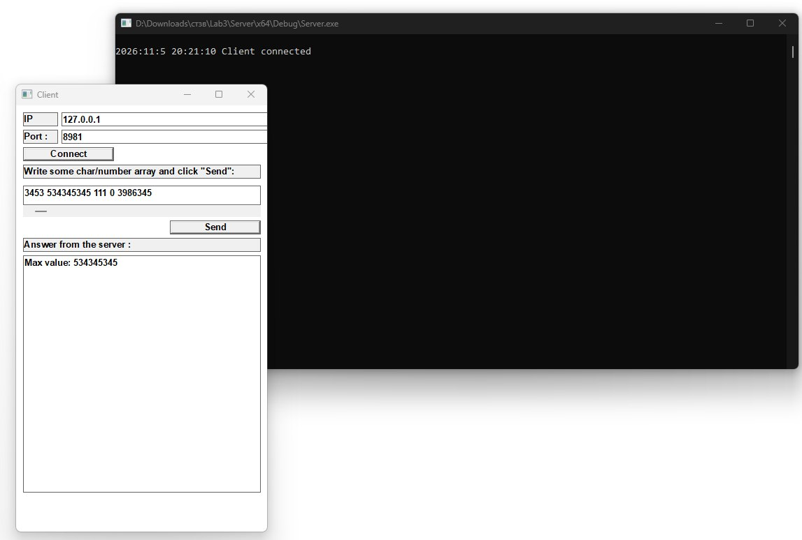

*This is a simple client-server architecture model.*

`Client connects, sends set of numbers, and the server returns the maximum out of them.`

**Demonstration**

It is possible to connect more than one client at the same time.
